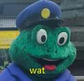

I'm  Jack, a statistician, data scientist and educator based in the north east. Nice to meet you.

I'm currently a senior data scientist at [UKHSA](https://www.gov.uk/government/organisations/uk-health-security-agency) primarily working on short-term forecasting and nowcasting models for seasonal pathogens and outbreak response. I completed all my studies at Newcastle University. I hold a PhD in Statistics (2023) and also obtained a First class MMathStat (2018) and continue to make the occasional academic contributions.

From a professional perspective, I am interested in epidemic modelling, RAP, production-ready modelling software, technical leadership and team structures, and developing others. I'm donated a lot of my time to the [Royal Statistical Society](rss.org.uk); serving and chairing the Young Statisticians Section and I'm also treasurer or the North Eastern local group.

When I'm not doing massive nerd stuff I'm probably doing some type II fun. I fill my free time with cycling, climbing and walking the dog. The dog is called Robin and I don't know what breed he is.

{width=0.1%}
